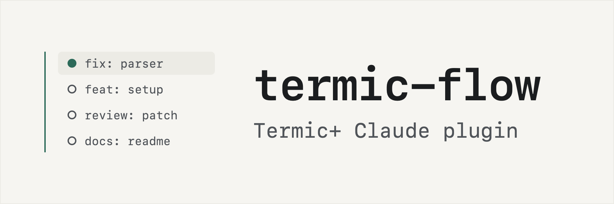

<picture>
   <source media="(prefers-color-scheme: dark)" srcset="img/banner-dark.png">
   
</picture>

# termic-flow

A Claude Code plugin developed for Termic+. It splits engineering work into Termic+ tasks, and each change gets its own git worktree, agent, review tab and scratchpad report. You watch progress in the Termic+ sidebar instead of scrolling back through chat.

It is built for Termic+, not the standard Termic app. Termic+ will be released soon.

Runs, packets, reports and reviews are Termic scratchpads, and progress shows up as tab props (`phase`, `blocked`) and group colours. Every archive, apply or tab close re-reads the task right before acting, and the destructive ones need a per-task approval that only you can give. A refused command goes into a script you can run later instead of being retried. Workers get the id of a short evidence packet rather than pasted context, and mechanical reads run as code (`tf snapshot`, `tf audit`) or on Haiku. The core `drive` skill is about 260 tokens, and its longer rules load only when a step needs them.

Only Claude agents are supported for now.

## Documentation

- [Getting started on an existing project](docs/getting-started.md)
- [Workflows](docs/workflows.md)
- [Scenarios](docs/scenarios.md)
- [How-to](docs/how-to.md)

## Requirements

- Termic+ with the CLI enabled in Settings (`$TERMIC_CLI` is set inside Termic+ tasks)
- Claude Code with plugin support
- Python 3.9 or newer (standard library only)

## Install

```sh
git clone https://github.com/stafawashere/termic-flow ~/dev/termic-flow
claude plugin marketplace add ~/dev/termic-flow
claude plugin install termic-flow@termic-flow
```

To try it for one session without installing, run `claude --plugin-dir ~/dev/termic-flow`.

## Workflows

| Command | What it does |
|---|---|
| `/termic-flow:dispatch <kind> <subject> "<goal>"` | Creates one work task with a packet, a routed model and a group |
| `/termic-flow:review <task>` | Opens a fresh review tab, using Opus for high-risk diffs |
| `/termic-flow:land <task>` | Asks the manual-test question, applies or opens a PR, then queues cleanup |
| `/termic-flow:triage "<symptom>"` | Reproduces the bug and proves the root cause read-only, then hands off to dispatch |
| `/termic-flow:plan-build "<idea>"` | Writes a sliced spec, waits for your approval, then builds, reviews and lands each slice |
| `/termic-flow:setup` | Sets up a new or existing project: detects checks and rules, writes `.termic-flow.json`, creates the hub tasks, then audits and restructures the sidebar with your approval |
| `/termic-flow:update` | Brings a project up to the installed plugin version: migrates its profile, reports legacy skills to retire, and re-checks hubs and the sidebar |
| `/termic-flow:status` | One-line status, with the details in the run pad |

Task kinds are `feat`, `fix`, `redesign`, `perf`, `docs`, `chore`, `review`, `ops` and `audit`. Use `audit` for read-only investigations that end in a report.

## Your part

These commands are yours to run. The plugin's hook blocks the agent from running them, though `--help` on any of them is allowed.

```sh
! tf approve <task-id>                      # allow archive / tab close for this task
! tf tested <task-id> "what you exercised"  # the manual-test answer; unlocks apply and PRs
! tf accept <task-id> "reason"             # override a rejected report, reason logged
! bash <fallback script>                    # run anything Claude Code or Termic refused
```

## Keeping a run moving

The orchestrator names its own task `ops: <workflow> <slug>` when a run starts, so it is easy to find in the sidebar.

- **Review rounds.** When a review fails and the worker fixes it, `tf tab <task> review --round 2 --report <previous review pad>` opens a `review-r2` tab that re-checks only the fixed findings.
- **Report rounds.** Workers write a new `report: <task> r<N>` pad for each attempt. `tf report` reads the newest round and says which one it read.
- **Expected failures.** A check named `red_<name>` must exit non-zero. Workers use it to record a deliberate break of their fix, so a passing report can show the tests catch it.
- **Silent workers.** `tf run stall-check` nudges a task that has made no progress for `stall_minutes` (default 10) once, then marks it blocked if it stays silent. A busy worker never counts as silent before its nudge.
- **Picking a run back up.** `tf run resume <slug>` prints the next action for every task in the run, even after the run has closed, and lists report pads the run log never mentioned.
- **Heavy commands.** Workers run full test suites and builds in the background with output to a file, with at most two heavy jobs at once. The guard warns a worker that runs one in the foreground.
- **Main checkout.** `tf audit` flags uncommitted changes on the main checkout as `dirty_main`.

A run closes on its own once no live task from it remains.

## Getting started

Inside a Termic+ task in your project, run `/termic-flow:setup`. On a project that already has a profile, it switches to `/termic-flow:update`, so running either one is safe.

## Configure

`/termic-flow:setup` writes `.termic-flow.json` at your project root and keeps it out of git through `.git/info/exclude` (`--share` commits it instead). Everything in it is optional, and you can edit it by hand.

```json
{
   "extends": "termic-plus",
   "checks": [{ "name": "unit", "run": "timeout 600 npm test" }],
   "read_first": ["CLAUDE.md"],
   "land": { "mode": "apply" },
   "stall_minutes": 10,
   "build": { "isolate": true, "env": { "CARGO_TARGET_DIR": "{worktree}/target" } },
   "forbid": { "commands": ["make release"], "paths": ["CHANGELOG.md"] },
   "hooks": { "require_timeout": true, "ban_dashes": true },
   "routing": { "rules": [{ "id": "my-review", "roles": ["review"], "model": "opus" }] }
}
```

Settings merge in this order, with later layers winning: `profiles/default.json`, then `~/.config/termic-flow/profile.json`, then the profile named by `extends`, then the project file. `profiles/termic-plus.json` is a complete worked example.

### Model routing

`tf route impl --kind perf` prints the model it chose and the rule that picked it. `tf route --explain` prints the whole table.

| Role | Default |
|---|---|
| scout, packer, audit, status | Haiku |
| orchestrator, impl, review | Sonnet |
| plan, spec, repro (triage), redesign and perf impl, ambiguous or cross-component impl, high-risk review | Opus |

When a worker fails with `failure: reasoning`, it is retried once on the same model, then moved up one rung. Environment failures never escalate. Fable is only used when you set `"allow_fable": true`.

You can override the defaults in `~/.config/termic-flow/routing.json` or under `"routing"` in the project file. Rules you add are checked before the defaults, and project rules are checked before user rules.

## Development

```sh
timeout 120 python3 -m unittest discover -s tests -t .
claude plugin validate --strict .claude-plugin/plugin.json
```

The tests run against `tests/fake/termic-cli`, which reads its state from a JSON world file and can simulate refusals, vanishing tasks and forced exit codes. See [CONTRIBUTING.md](CONTRIBUTING.md). Release notes are in [CHANGELOG.md](CHANGELOG.md).

## License

MIT
